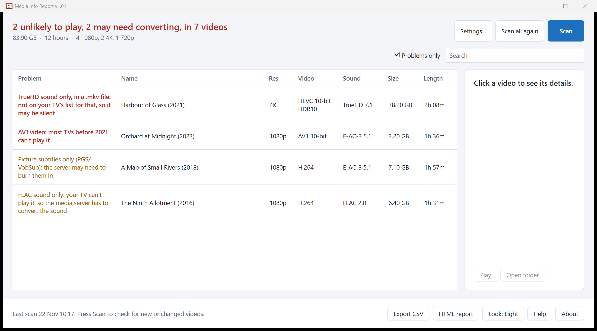

  

# Media Info Report

Resolution, codecs, audio and size for every video, and which ones a TV may not play.

    

## ✨ Features

Media Info Report is a PowerShell/WPF tool that lists every video in your folders with its resolution, video format, sound, subtitles, size and length, and points out the ones your TV may not play directly. It only reads the files.

- **Everything about each video**: resolution (4K, 1080p, 720p, SD), video format and bit depth, HDR10, HDR10+, HLG or Dolby Vision, every sound track (DTS-HD MA 7.1, E-AC-3 Atmos...), subtitles, size, length and bit rate.
- **Will it play on the TV?** Red for files unlikely to play directly (a format your TV doesn't play, 10-bit H.264, or sound it can't decode), amber for ones your media server may have to convert (old XviD or AVI files, picture-only subtitles, very high bit rates). Pick your TV in **Settings...** (or tick what it plays) and the checks follow.
- **Ready-made TVs**: Sony BRAVIA XR-42A90K (2022) (video and sound formats from Sony's list for that TV), plus general guides for a typical 4K HDR smart TV, a recent 4K TV with AV1 and Dolby Vision, and an older HD TV. A tick for a sound bar or AV receiver on eARC lets TrueHD and DTS-HD sound through. For TVs that read DTS only from MKV files, as the XR-42A90K does, DTS-only sound in other files is flagged.
- **File-type checks for the XR-42A90K**: each file is checked against [Sony's list](https://helpguide.sony.net/tv/jaep1/v1/en/04-01-03_03.html) of the video, sound and picture size each file type can hold. That list is for the TV's own player; apps on the TV may play more, and frame rates, levels and sample rates aren't checked.
- **Quick, and quicker next time**: four files are read at a time in the background, and the results are kept, so a later scan only reads new or changed files.
- **Export CSV**: saves the videos shown in the list as a CSV file for Excel and other spreadsheets (untick Problems only and clear the search to save them all).
- **Excel-safe CSV**: opens correctly with a double-click, with names such as 1917, 007 or 3-10 as typed. Such names are written as `="1917"` in the file, which programs other than spreadsheets will show as they are; ordinary titles are untouched.
- **HTML report**: saves the same videos as a page, coloured red, amber and green, with search, sorting and a Problems only switch, to open in any browser, print or share.
- Totals (size, hours, how many 4K / 1080p), Problems only, search, Play and Open folder, light and dark looks, Help and an About box.

## 🖼️ Screenshots

## 📋 Requirements

- Windows 10 or 11.
- Windows PowerShell 5.1 (built into Windows) with .NET Framework 4.7.2 or later.
- **ffprobe**, part of the free [FFmpeg](https://ffmpeg.org). The easiest way: `winget install Gyan.FFmpeg` in a command window. The app finds it by itself, or you can point **Settings...** at your own `ffprobe.exe`.

## 📦 Installation

1. Download `Media-Info-Report-v1.03.zip` from the [latest release](../../releases/latest) and unzip it wherever you like to keep it.
2. Double-click **Media Info Report.cmd** in the unzipped folder. It makes a **Media Info Report** shortcut there and in the Start menu, and starts the tool. From then on, use the shortcut, the Start menu or a pinned taskbar button.

Nothing is installed and no Windows settings are changed. The shortcut runs the script with PowerShell's execution policy bypassed for that run only.

**From the repo:** clone it and double-click **Start Media Info Report.cmd**.

### Why no exe

Home tools used to ship as PS2EXE exes, and antivirus programs (ESET among them) kept flagging those exes as generic trojans by mistake. A plain script and a shortcut give the same one-click start without the false alarms, and you can read exactly what runs.

### Build a release

Double-click **Build.cmd** in the repo folder. It reads `build.json`, checks every script for syntax errors and that `$script:AppVersion` matches the newest `CHANGELOG.md` entry (if the version lives in a file of its own, add `"VersionFile": "src\\<file>.ps1"` to `build.json`; that file can call it `$script:<Name>Version`), runs PSScriptAnalyzer if it's installed, copies the release files into `..\Builds\Media Info Report v<version>\`, zips that folder for the GitHub release, refreshes `..\Builds\Media Info Report.lnk` (what the Home Launcher starts) and scans the result with ESET's command-line scanner if it's installed.

## 🚀 Usage

1. Start Media Info Report (the shortcut, the Start menu, or **Media Info Report.cmd**).
2. Press **Settings...**: add your video folders (your Videos folder is there to begin with; NAS shares and mapped drives work too) and pick your TV under **Your TV** (the Sony BRAVIA XR-42A90K to begin with), or tick what it plays. **Remove folder...** takes a folder off the list without touching its files.
3. Press **Scan**. Click a video for its details; **Problems only** shows just the ones that may not play.

## ⚙️ Configuration

**Where settings live:** `%APPDATA%\Media Info Report`, never inside the repo or a release folder.

- `settings.json`: the look, the video folders, ffprobe's place (blank: found by itself) and your TV (its name and what it plays).
- `results.json`: the last scan, so the next one only reads new or changed files.
- `Media Info Report.log`: scans and anything that went wrong.

## 📝 Changelog

See [CHANGELOG.md](CHANGELOG.md).

## 📄 Licence

[MIT](LICENSE). Copyright (c) 2026 Jason Rhodes.

Created by Jason Rhodes, built with Claude (Anthropic).
